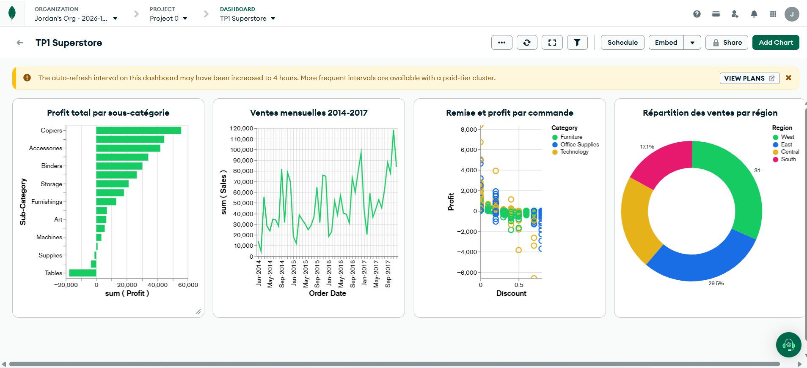
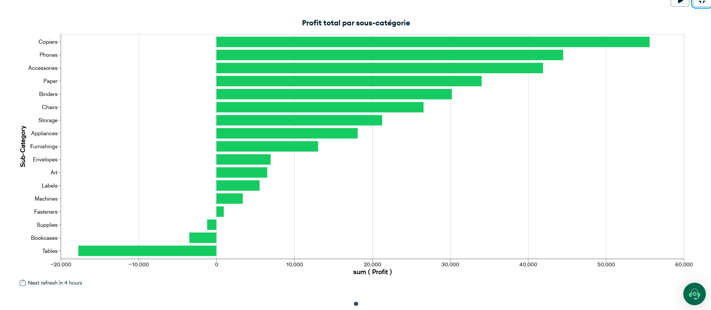
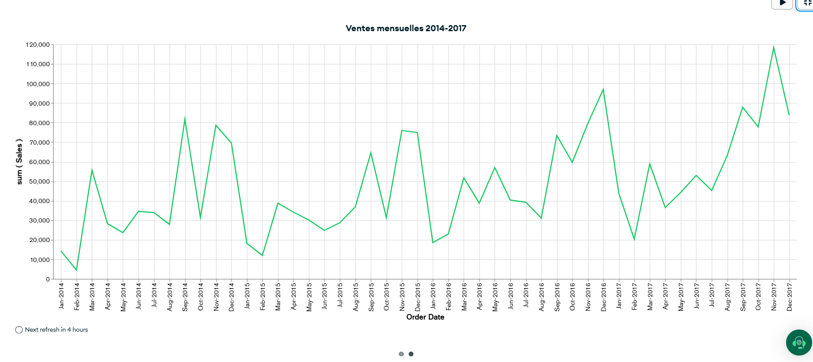
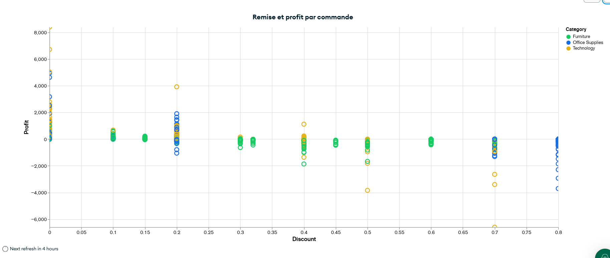
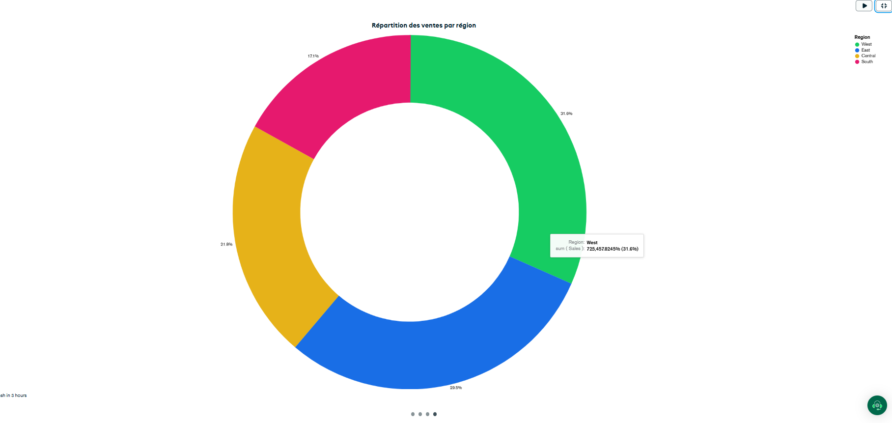

# Analyse des ventes Superstore avec MongoDB Atlas

Travail pratique réalisé dans le cours SDD-1003 Gestion des entrepôts de données, à l'Université du Québec à Trois-Rivières (automne 2026).

Le point de départ est une question simple : le magasin vend de plus en plus, mais est-ce que toutes ces ventes rapportent de l'argent ? Pour y répondre, j'ai chargé un jeu de données de ventes dans MongoDB Atlas, écrit quatre requêtes MQL dans mongosh, puis construit un tableau de bord de quatre graphiques dans Atlas Charts.



## Données

[Superstore Dataset](https://www.kaggle.com/datasets/vivek468/superstore-dataset-final) (Kaggle, Vivek Chowdhury) : 9 994 lignes de commande d'un magasin américain de fournitures de bureau, de mobilier et de produits technologiques, de 2014 à 2017. Une ligne correspond à un produit dans une commande. Le fichier CSV n'est pas inclus dans ce dépôt : il appartient à son auteur et se télécharge sur Kaggle, selon les conditions indiquées sur la page du jeu de données.

## Outils

- MongoDB Atlas, cluster gratuit M0
- MongoDB Compass pour l'import
- mongosh pour les requêtes
- Atlas Charts pour les visualisations

## Préparation des données

C'est l'étape qui a demandé le plus d'ajustements.

**Fichier CSV mal formé.** À l'aperçu de l'import dans Compass, une partie des lignes tombait entièrement dans la colonne Row ID. Chaque ligne se terminait par un point-virgule, et 2 510 lignes (celles dont le nom de produit contient une virgule) étaient entourées de guillemets d'un bout à l'autre. J'ai corrigé le format sans toucher aux valeurs ; après correction, les 9 994 lignes avaient bien 21 colonnes.

**Typage.** Les types ont été fixés à la main dans Compass : `Sales`, `Discount` et `Profit` en Double, `Quantity` et `Row ID` en Int32. Les données sont dans la base `superstore`, collection `commandes`.

**Dates.** `Order Date` et `Ship Date` étaient au format américain mois/jour/année et ont été importées comme texte. Tant qu'elles restent du texte, impossible de filtrer par période ou d'extraire une année. Je les ai converties en type Date avec un `updateMany` basé sur un pipeline (`$split`, `$toInt`, `$dateFromParts`). Voir [`requetes/01_conversion_dates.js`](requetes/01_conversion_dates.js).

## Requêtes

Le code complet est dans [`requetes/02_requetes_analyse.js`](requetes/02_requetes_analyse.js).

| # | Question | Opérations |
|---|----------|------------|
| 1 | Quels meubles remisés à 30 % et plus (Ouest et Centre) perdent le plus ? | `find`, `$in`, `$gte`, `$lt`, projection, `sort`, `limit` |
| 2 | En 2017, combien de lignes ont une remise ≥ 50 % ou une perte > 500 $ ? | `countDocuments`, intervalle de dates, `$or` |
| 3 | Quelles sous-catégories rapportent, lesquelles perdent, avec quelle marge ? | `aggregate` : `$group`, `$project`, `$round`, `$divide`, `$sort` |
| 4 | Comment évoluent ventes, volume et remise moyenne d'une année à l'autre ? | `aggregate` : `$group` sur `$year`, `$avg`, `$sort` |

Exemple, la requête 3 :

```js
db.commandes.aggregate([
  { $group: { _id: "$Sub-Category", ventes: { $sum: "$Sales" }, profit: { $sum: "$Profit" }, nb: { $sum: 1 } } },
  { $project: { ventes: { $round: ["$ventes", 2] }, profit: { $round: ["$profit", 2] }, nb: 1,
      marge_pct: { $round: [{ $multiply: [{ $divide: ["$profit", "$ventes"] }, 100] }, 1] } } },
  { $sort: { profit: 1 } }
])
```

## Ce que montrent les résultats

- **Les ventes progressent** : de 484 247 $ en 2014 à 733 215 $ en 2017 (environ +51 %), avec un recul léger en 2015. Les pics reviennent chaque année en septembre, novembre et décembre.
- **Trois sous-catégories perdent de l'argent** sur la période : Tables (-17 725 $, marge de -8,6 %), Bookcases (-3 473 $) et Supplies (-1 189 $). Les Tables font près de 207 000 $ de ventes et pourtant la plus grosse perte.
- **Le volume ne dit pas la rentabilité** : Copiers dégage environ 55 600 $ de profit (marge de 37 %) avec seulement 68 lignes, alors que Machines vend pour 189 000 $ avec une marge de 1,8 %.
- **Les fortes remises coûtent cher** : à partir de 30 % de remise, la plupart des lignes passent à perte, et au-delà de 50 % il n'y a plus que des pertes. En 2017, 309 lignes sur 3 312 (environ 9 %) ont une remise ≥ 50 % ou une perte de plus de 500 $.
- **La remise moyenne reste stable** autour de 15,6 % chaque année. Ce n'est donc pas la politique de remise dans son ensemble qui pose problème, mais les remises très fortes sur certains produits.

Limite : le nuage de points montre une association entre remise et profit, pas une relation de cause à effet. Le type de produit ou la quantité jouent probablement aussi.

## Visualisations (Atlas Charts)

| Profit par sous-catégorie | Ventes mensuelles 2014-2017 |
|---|---|
|  |  |

| Remise et profit par ligne de commande | Ventes par région |
|---|---|
|  |  |

## Contenu du dépôt

```
requetes/
  01_conversion_dates.js     conversion texte -> Date
  02_requetes_analyse.js     les quatre requêtes de l'analyse
images/                      captures mongosh, Atlas et Atlas Charts
rapport/
  TP1_MongoDB_Atlas_Superstore.pdf   rapport remis
```

## Reproduire

1. Créer un cluster Atlas (le niveau gratuit M0 suffit) et télécharger le CSV sur Kaggle.
2. Corriger le format du fichier si l'aperçu d'import montre des colonnes décalées (voir plus haut).
3. Importer dans `superstore.commandes` avec Compass en fixant les types numériques.
4. Dans mongosh : `use superstore`, puis lancer `01_conversion_dates.js` et les requêtes de `02_requetes_analyse.js`.

## Auteur

Jordan Kouayep Mbakop, étudiant au baccalauréat en informatique, UQTR.
